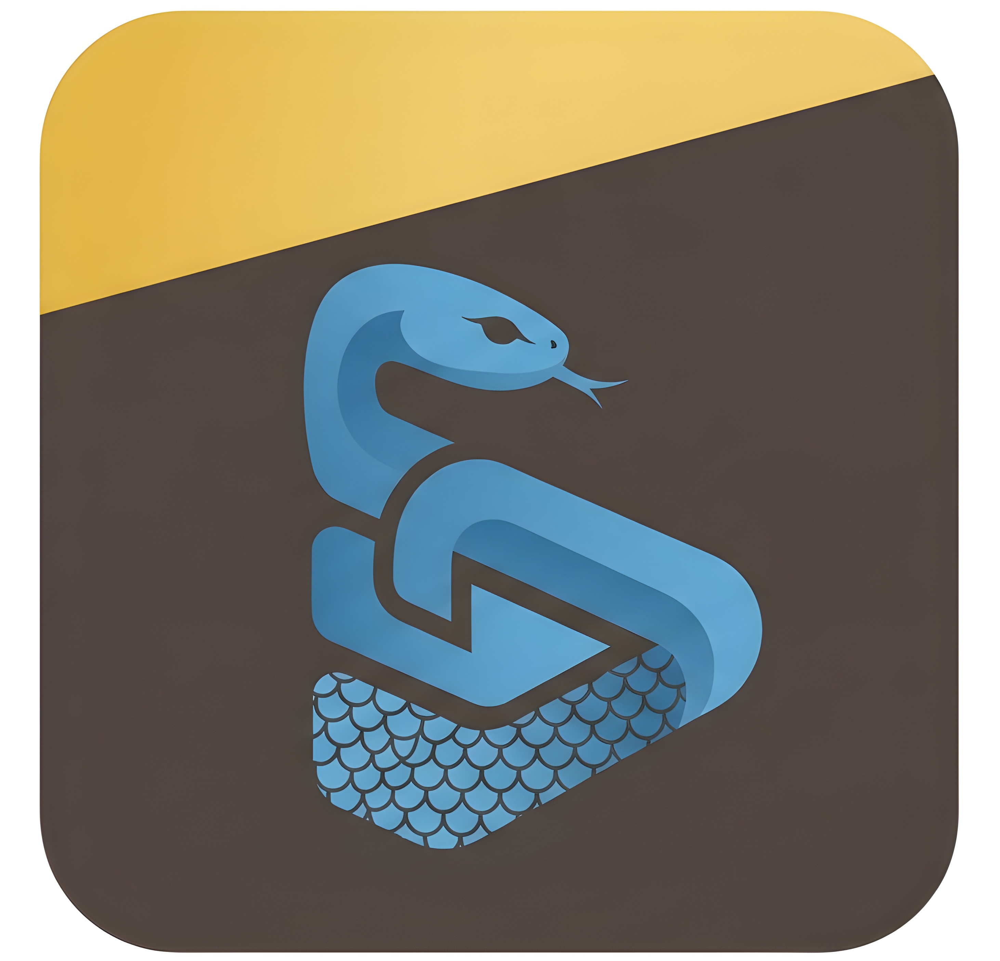

# <picture>
  <source media="(prefers-color-scheme: dark)" srcset="assets/logo.png">
  <source media="(prefers-color-scheme: light)" srcset="assets/logo.png">
  
</picture> garmin-ble

[](https://pypi.org/project/garmin-ble/)
[](https://pypi.org/project/garmin-ble/)
[](https://www.gnu.org/licenses/agpl-3.0)

A clean-room Python implementation of Garmin's proprietary BLE protocol (GFDI V2). Stream live telemetry from your Garmin watch directly to your computer: no cloud, no phone, no Garmin Connect required.

<p align="center">
  <a href="https://github.com/gwerneckp/garmin-ble/blob/main/assets/garmin-ble-announcement.mp4">
    
  </a>
  <br>
  <sub><a href="https://github.com/gwerneckp/garmin-ble/blob/main/assets/garmin-ble-announcement.mp4"><b>Watch the full announcement video</b></a> (80s, with sound)</sub>
</p>

---

## Features

- Live telemetry over BLE, without Garmin Connect:
  - heart rate and resting heart rate
  - daily steps and step goal
  - heart rate variability (HRV)
  - blood oxygen (SpO2)
  - respiration rate
  - calories (total and active)
  - intensity minutes
  - stress level
  - Body Battery
  - accelerometer
- Typed metrics. Each reading is a dataclass with named fields.
- Subscribing to a metric starts its service on the watch. The last unsubscribe stops it.
- The full GFDI V2 stack:
  - handshake (`CLOSE_ALL`, `REGISTER_ML`)
  - MLR (Multi-Link Routing) packet multiplexing
  - COBS (Consistent Overhead Byte Stuffing) encoding and decoding
  - compiled protobufs for `gdi_smart_proto`
  - CRC16 checks
- Reconnection with exponential backoff. Subscriptions are restored after a BLE drop.
- A periodic time-sync heartbeat that keeps the link alive.
- A simulator and session replay, so you can develop, test, and reproduce bugs without a watch.
- Per-session capture files and live protocol diagnostics.
- Pure Python. No binary blobs or proprietary SDKs.

---

## Installation

```bash
pip install garmin-ble
```

Or install from source with dev dependencies:

```bash
git clone https://github.com/gwerneckp/garmin-ble.git
cd garmin-ble
pip install -e ".[dev]"
```

---

## Quick start

```python
import asyncio
from garmin_ble import Watch, metrics

async def main():
    async with Watch.discover() as watch:
        print(f"Connected to {watch.info.name}")

        async for reading in watch.stream(metrics.HEART_RATE):
            print(f"❤️  {reading.bpm} BPM (resting {reading.resting_bpm})")

asyncio.run(main())
```

The session owns connecting, the GFDI handshake, the keep-alive heartbeat, and
reconnection. Leaving the block always disconnects, including on `Ctrl+C`.
Subscribing to a metric registers and starts its service on the watch, and the
last unsubscribe stops it.

Callbacks also work, both sync and `async def`:

```python
@watch.on(metrics.HEART_RATE)
async def _(reading: metrics.HeartRate) -> None:
    await store(reading.bpm)
```

### No watch on hand

Swap the factory and the same code runs without hardware, which is useful for
development, examples, and CI:

```python
async with Watch.simulated(profile="fenix7") as watch:   # in-process watch
async with Watch.replay("session.gble") as watch:        # a recorded session
```

`watch.record(path)` writes a capture that `Watch.replay` reads back, so a
protocol bug can be reproduced by someone who does not own the watch.

### Reading device state

```python
battery = await watch.battery()          # -> Battery(percent=88, status="ok")
result  = await watch.collect(timeout=60)  # one sample of every metric
print(result)                              # renders a ✅/⏳ checklist
```

Failures raise exceptions. `WatchNotFound` lists the devices the scan did see.
`HandshakeError` names the stage where the handshake stopped.
`ServiceUnavailable` is raised when the watch declines a metric, so you don't
end up waiting on a stream that never yields.

> [!TIP]
> Disconnect your watch from your phone's Bluetooth first. Garmin watches accept only one BLE connection at a time. If discovery fails, run `python examples/scan.py`. It lists every device in range and says why none matched.

The [`examples/`](./examples/) directory has complete scripts:
`telemetry_basic.py` (simplest start), `telemetry_advanced.py` (every stream at
once, reconnection, diagnostics), `device_state.py` (protobuf in both
directions), `full_walkthrough.py` (verify every feature), and
`accelerometer_3d.py` (live 3D orientation). Most accept `--simulate`.

The demos from the video are there too:
`python -m examples.tilt` (a 3D marble game you steer by tilting your wrist),
`python -m examples.death_bed` (an ICU-style bedside monitor), and
`pulse_orb.py` (an orb that pulses with your heart rate and changes colour with your stress).

---

## Status and roadmap

[ROADMAP.md](./ROADMAP.md) and the [GitHub issues](https://github.com/gwerneckp/garmin-ble/issues)
list planned features, known gaps, and work in progress. Each milestone is a
release:

| Release | Goal | Status |
|---------|------|--------|
| v0.1.0 | BLE transport and handshake | Done |
| v0.2.0 | Live telemetry streaming | Done |
| v0.3.0 | `Watch` API, transports, simulator, and replay | Done |
| v0.4.0 | Protobuf settings and device state | In progress |
| v0.5.0 | Notifications and media control | Planned |
| v0.6.0 | File transfers (FIT and GPX downloads) | Planned |
| v1.0.0 | Stable release | Planned |

---

## Design philosophy

`garmin-ble` is a wire-protocol library. It encodes, sends, decodes, and responds to Garmin's BLE protobufs, and that is all it does.

The library does not fetch weather from OpenWeatherMap, sync calendars over CalDAV, or play a sound when the watch asks to find your phone. It gives you protobuf encoding and decoding, callbacks for incoming messages, and transport helpers. Your code handles OS integration, external APIs, and anything user-facing.

This keeps the library small and testable, and keeps integrations out of it.

If you want an open-source replacement for the Garmin Connect app on Android, use [Gadgetbridge](https://codeberg.org/Freeyourgadget/Gadgetbridge).

## Why

Garmin watches record a lot of physiological data, and Garmin Connect keeps it in Garmin's cloud. This library reads it straight from the watch over BLE, with no internet connection.

---

## Contributing

Contributions are welcome, especially test reports from watch models that haven't been tried yet. See [CONTRIBUTING.md](./CONTRIBUTING.md).

---

## Acknowledgements and license

This project builds on the reverse-engineering work of the [Gadgetbridge](https://codeberg.org/Freeyourgadget/Gadgetbridge) team. The protocol logic, COBS decoding, and `.proto` schemas are derived from their open-source Java implementation.

Licensed under the GNU Affero General Public License v3.0 (AGPL-3.0). See [`LICENSE`](./LICENSE).
